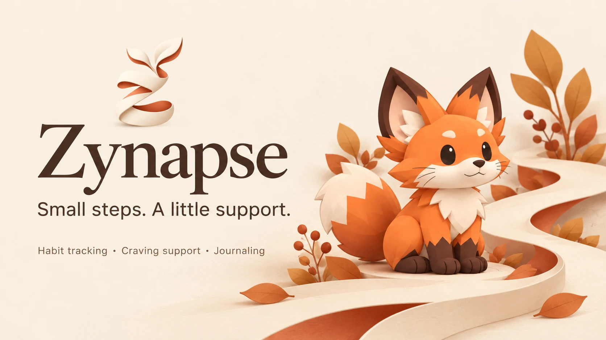
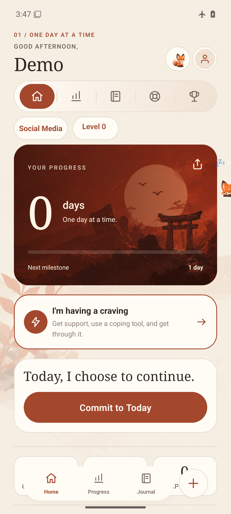
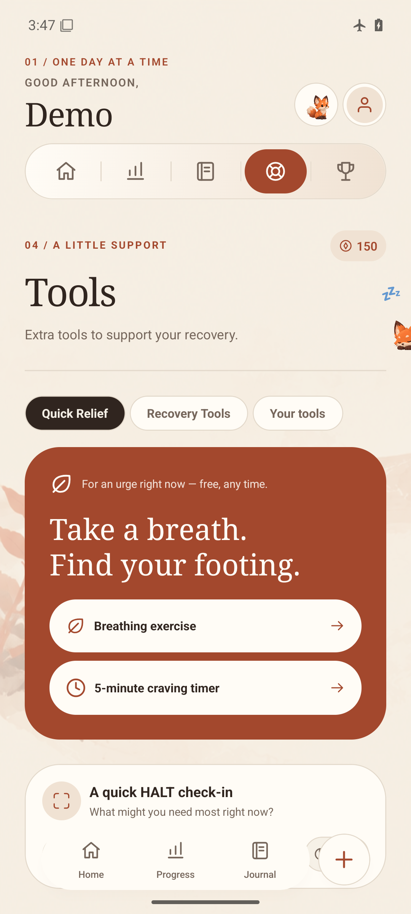
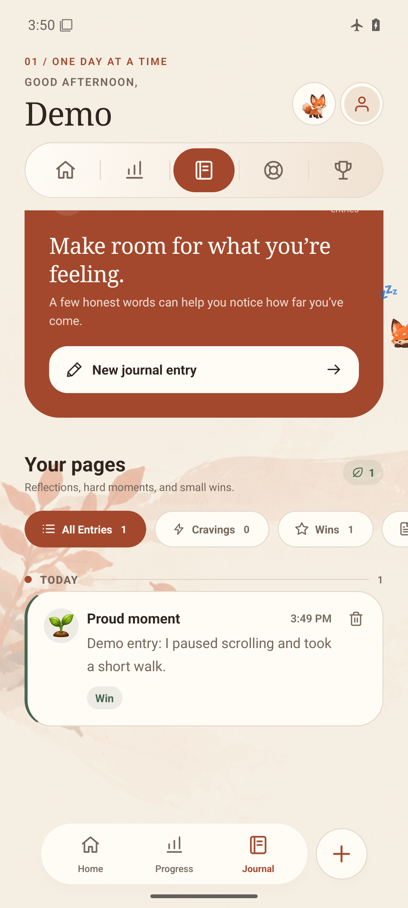

# Zynapse

Small steps. A little support.

Zynapse is a local-first habit recovery tracker for people who want to reduce or leave an unwanted habit. Track your days, get support during cravings, reflect in a journal, and grow alongside a fox companion.

This is the public product and support repository. The application source is maintained separately and is not published here.

[Website](https://zynapse.zynoks.com/) · [Installation](guides/INSTALLATION.md) · [Getting started](guides/GETTING_STARTED.md) · [Help](SUPPORT.md)

## Availability

**Zynapse is in development. No public installer is published in this repository yet.**

| Platform | Current status |
| --- | --- |
| Android | Signed preview APK verified locally: version 1.0.0, build 9. Public distribution is pending review. |
| iPhone / iPad | Planned in the project; no verified distributable build or App Store listing. |
| Windows, macOS, Linux | No desktop installers or verified desktop builds. |
| Web | The product website is live. It is not a browser version of the tracker. |

The Android preview uses a release build, but it is an internal preview rather than a stable public release. Android emulator checks cover setup, saved data after restart, the app guide and companion interactions. Physical-device coverage remains limited. See [release notes](RELEASE_NOTES.md) for the scope of verification.

The [website download page](https://zynapse.zynoks.com/download) currently shows availability information, not working store downloads. There is no verified public APK URL to recommend today. Future approved installers belong in release assets, never in this repository's Git history.

## What you can do

These features are implemented in the current Android preview; they are not claims of a stable public launch.

- Track preset or custom habits, streaks and estimated savings. The free interface supports up to three habits.
- Log cravings, moods and slips. Recording a slip and resetting a streak are separate choices.
- Open breathing, grounding, urge-surfing and timer tools when you need support.
- Write journal entries and save your reasons for making a change.
- Review recorded activity, craving intensity, triggers and coping-tool use in Progress.
- Make recovery plans, daily commitments and messages for your future self.
- Earn levels and cosmetic rewards, and interact with a growing fox companion.
- Choose English, French or Arabic, and light or dark appearance.

Core tracking works locally without an account. Optional account backup, subscriptions, rewarded ads and device services have additional configuration and verification limits; they are not advertised as production-ready services. Read the [FAQ](guides/FAQ.md).

## Inside the app

The images below are real captures of the unmodified Android 1.0.0 build 9 preview in an isolated emulator. The profile and activity are demonstration data. The cover above is generated promotional illustration, not a screenshot.

  
  
  

[Image provenance and generation prompt](assets/IMAGES.md)

## Your first few minutes

1. Once an approved preview is available, follow the [installation guide](guides/INSTALLATION.md).
2. Choose your name, language, currency and appearance. Add a habit and its daily baseline.
3. Follow the short app guide, or replay it later from Settings.
4. Use Home for your selected habit, the **+** button to record activity, and Tools for support.
5. Open Journal to reflect and Progress to review what you have recorded.

[Full walkthrough](guides/GETTING_STARTED.md)

## Updates and your data

Install a newer compatible signed APK over the existing app to retain local data. Do not uninstall first. No automatic update feed is established for this preview.

Settings offers a partial JSON export of habits, journal and profile. **It is not a complete backup, and there is no in-app import for that export.** Do not uninstall, clear app storage or reset data expecting this file to restore everything. Optional account snapshots are not a verified production backup service.

See [backup, restore and uninstall](guides/BACKUP_AND_RESTORE.md) and [troubleshooting](guides/TROUBLESHOOTING.md).

## Current limitations

- Broader physical-device, compact-screen and language coverage is still being tested.
- Switching into or out of Arabic may require fully closing and reopening the app to apply layout direction.
- Savings are estimates based on your entered baseline. Progress reflects recorded activity, not a medical assessment or a guarantee of recovery.
- Some milestone celebrations and craving totals differ across screens and remain under review.
- Cloud snapshots do not merge simultaneous changes across devices. Production sync, purchases and ads are unverified.
- Complete local backup and restore are not available.

## Support and rights

Use [GitHub Issues](https://github.com/Zynokss/zynapse-app/issues) for reproducible bugs and feature requests, or email [support@zynapse.app](mailto:support@zynapse.app), the contact listed in the product. Email delivery has not been independently verified. Never post passwords, tokens, private journal text, exports or personal contact details in an issue.

[Support guide](SUPPORT.md) · [Product privacy policy](https://zynapse.zynoks.com/privacy) · [Product terms](https://zynapse.zynoks.com/terms) · [Rights and credits](RIGHTS.md)

This repository does not grant an open-source license to the application. Third-party rights remain with their respective owners. Zynapse is a tracking and reflection tool, not a replacement for professional care.
